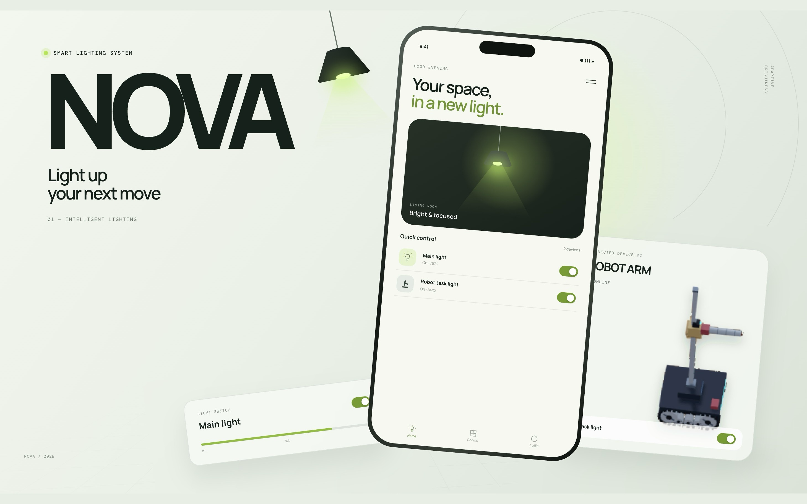

# NOVA: Non-connected Object Vision and Actuation for Smart Home Routines

> 26-2 Hanyang University Software Engineering Project

---

## 💁🏻‍♂️ Proposal

This project proposes NOVA, a system that lets a proactive smart-home agent operate controls that are not on the network: wall switches, toggles and power strips. Smart-home routines work only if every control the resident cares about is connected and registered, yet many are not, and in rented homes the wiring often cannot be changed.

In the proposed system, a camera finds each control and the system works out which device it operates, by watching the resident use it or by pressing it and comparing before and after. Routines then use these controls through wireless channels (Wi-Fi, IR, Bluetooth) first. When a wireless command fails and the Safety Guard finds no person or obstacle in the way, a robot presses the control and the camera checks the result. In the prototype, the robot is a set of linear actuators on a cart.

Every action is checked rather than assumed, high-risk devices always ask first, and every run updates channel scores and link confidence. The hub at home keeps the records and checks safety before every press. The backend runs on AWS, and recognition runs inside a Nitro Enclave there, so the photos the hub sends are sealed and opened only inside that trusted execution environment, and no video leaves the home. This proposal demonstrates how unconnected controls can take part in proactive smart-home routines without replacing them.

---

## ⚙️ System Architecture

---

## 📹 Video

**Demo video: coming soon**

Until then, the [web demo](https://sweg9.github.io/sim-demo/) runs the 20-second process (mapping, Wi-Fi failure, Safety Guard, physical press, camera check) in a browser, with no install. Its [source](https://github.com/sweg9/sim-demo/tree/main/web) also runs offline from a local copy.

---

## 📚 Documentation

[NOVA | Tech Blog](https://bit.ly/4Ckil0Z)

[NOVA | Development Wiki](https://sweg9.github.io/docs/)

[NOVA | SE Paper - PDF](https://sweg9.github.io/docs/papers/proposal.pdf)

[NOVA | SE Paper - LaTeX](https://github.com/sweg9/docs/blob/main/public/papers/proposal.tex)

NOVA | Presentation Slides - *coming soon*

---

## 👨🏻‍💻 Team Members

| Name | Organization | Email |
|------|---------------|-------|
| Geonhak Lee | Department of Information Systems, Hanyang University | [thisiscrane@hanyang.ac.kr](mailto:thisiscrane@hanyang.ac.kr) |
| Jemin An | Department of Information Systems, Hanyang University | [ajm6396@hanyang.ac.kr](mailto:ajm6396@hanyang.ac.kr) |
| Jiwon Han | Department of Information Systems, Hanyang University | [hjw9657@hanyang.ac.kr](mailto:hjw9657@hanyang.ac.kr) |
| Hyunseo Choi | Department of Information Systems, Hanyang University | [hyunseo615@hanyang.ac.kr](mailto:hyunseo615@hanyang.ac.kr) |
