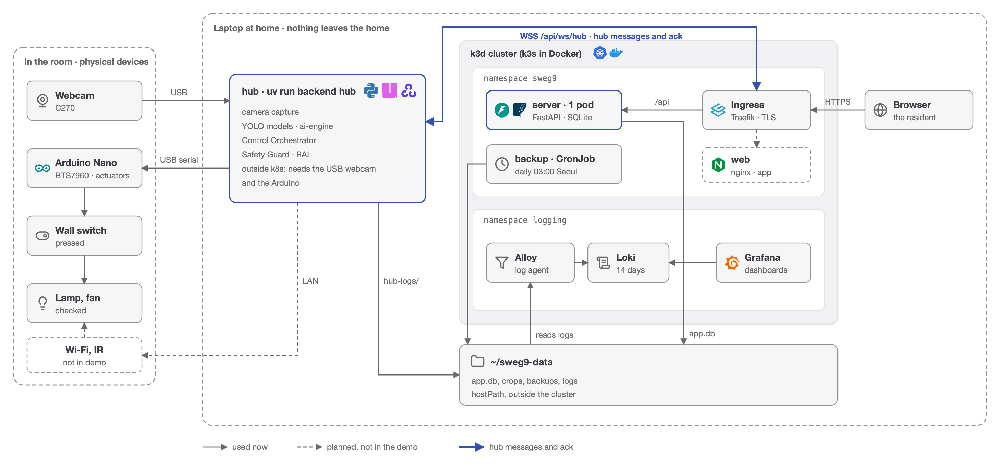

# NOVA

**Non-connected Object Vision and Actuation for Smart Home Routines**

> 26-2 Hanyang University Software Engineering Project

## Documents

**Reports**
- [Proposal (PDF)](https://sweg9.github.io/docs/papers/proposal.pdf): the reference document for the project
- [Development wiki](https://sweg9.github.io/docs/): every document below, with search and rendered API specs
- Presentation slides: *coming soon*

**Overview**
- [Introduction](https://sweg9.github.io/docs/overview/): the problem, the seven stages, autonomy by risk and privacy
- [Requirements](https://sweg9.github.io/docs/product/requirements): FR-01 to FR-12, owners and how each is built
- [Architecture](https://sweg9.github.io/docs/overview/architecture): parts, data and interfaces
- [Stack](https://sweg9.github.io/docs/overview/stack): run modes, libraries, Kubernetes, logging and backups

<b>Design · 4 docs</b>

- [Database](https://sweg9.github.io/docs/overview/database): tables, enums and migrations
- [Modules](https://sweg9.github.io/docs/overview/modules): code layout of each repo
- [Models](https://sweg9.github.io/docs/product/models): detectors, state classifier and fingerprints
- [Related work](https://sweg9.github.io/docs/overview/related-work): what existing products and research leave open

<b>API · 4 docs</b>

- [Conventions](https://sweg9.github.io/docs/api/): rules shared by every API
- [backend-server API](https://sweg9.github.io/docs/api/backend-server): the HTTP API for the web app
- [Hub messages](https://sweg9.github.io/docs/api/hub-messages): WebSocket messages between the hub and the server
- [ai-engine interface](https://sweg9.github.io/docs/api/ai-engine): what the hub calls in ai-engine

<b>Data, demo and environment · 5 docs</b>

- [Labeling spec](https://sweg9.github.io/docs/dataset/labeling): how switch-panel photos are labeled
- [Dataset plan](https://sweg9.github.io/docs/dataset/PLAN): collection and split plan
- [live-demo plan](https://sweg9.github.io/docs/live-demo/PLAN): the web app and the demo screens
- [Simulator](https://sweg9.github.io/docs/product/simulator): Unity and web simulator, current state
- [Development environment](https://sweg9.github.io/docs/product/environment): tools and setup

<b>Standards · 5 docs</b>

- [Common rules](https://sweg9.github.io/docs/standards/common): rules C-01 to C-13 for every repo
- [Data model](https://sweg9.github.io/docs/standards/data-model): shared vocabulary and enums
- [Execution log](https://sweg9.github.io/docs/standards/execution-log): the run log format
- [AI output](https://sweg9.github.io/docs/standards/ai-output): rules for model outputs
- [Per-repo obligations](https://sweg9.github.io/docs/standards/per-repo): what each repo must provide

<table>
<tr>
<td width="50%" valign="top">

### Overview

Smart-home routines work only if every control the resident cares about is on the network. Many are not: wall switches, toggles and power strips, and in rented homes the wiring often cannot be changed. NOVA lets a proactive smart-home agent use these controls anyway. A camera finds them, the system works out which device each one operates, and routines then use them through wireless channels or, when those fail, a physical press by a robot (linear actuators on a cart in the prototype).

</td>
<td width="50%" valign="top">

### Architecture

</td>
</tr>
</table>

### Three ideas

<table>
<tr>
<td width="33%" valign="top">

**The home learns its own controls**

A detector finds each control, and the system links it to a device by watching the resident use it or by pressing it and comparing before and after. The resident only confirms the link.

</td>
<td width="33%" valign="top">

**A command is not a result**

Every action is checked, from the state the platform reports or by camera. When wireless fails, the Safety Guard checks for people and obstacles, a robot presses the control and the camera checks the press.

</td>
<td width="33%" valign="top">

**Nothing leaves the home**

Recognition runs on the hub at home with local models, and the backend runs on the same laptop, so frames never go to the cloud.

</td>
</tr>
</table>

### Key Features

<table>
<tr>
<td width="33%" valign="top">

**Control recognition** 
Wall switches, toggles and power strips are detected, their state read and each saved with a picture fingerprint.

</td>
<td width="33%" valign="top">

**Device mapping** 
Each control is linked to the device it operates, and a link is used only after it is verified.

</td>
<td width="33%" valign="top">

**Proactive routines** 
Routines come from repeated habits or are built by hand, and the resident can keep, change or remove them.

</td>
</tr>
<tr>
<td valign="top">

**Wireless first, physical fallback** 
Channels (Wi-Fi, IR, Bluetooth) are ranked by learned score; if all fail, the robot presses the control.

</td>
<td valign="top">

**Autonomy by risk** 
Low-risk devices act and then tell; high-risk devices ask first and always notify.

</td>
<td valign="top">

**Learning from every run** 
Channel scores, link confidence and routine usefulness update after each run, even a cancelled one.

</td>
</tr>
</table>

<table>
<tr>
<td width="50%" valign="top">

### Tech Stack

| Layer | Technologies |
|---|---|
| Recognition | YOLO11, DINOv2, OpenCV 4 (local, CPU) |
| Backend | Python 3.11, FastAPI, WebSocket, APScheduler |
| Database | SQLite (WAL), SQLAlchemy 2, Alembic |
| Web app | React 18, TypeScript 5, Vite |
| Hardware | Arduino Nano, linear actuator, USB webcam |
| Infrastructure | k3d on one laptop at home, Grafana, Loki |
| Simulator | Unity 6, three.js |

</td>
<td width="50%" valign="top">

### Repositories

| Repo | Role |
|---|---|
| [ai-engine](https://github.com/sweg9/ai-engine) | Recognition on the hub |
| [backend-server](https://github.com/sweg9/backend-server) | FastAPI backend: `server` and `hub` modes |
| [dataset](https://github.com/sweg9/dataset) | Switch-panel photos and labels |
| [live-demo](https://github.com/sweg9/live-demo) | Resident web app and demo screens |
| [sim-demo](https://github.com/sweg9/sim-demo) | Unity simulator and web demo |
| [docs](https://github.com/sweg9/docs) | Development wiki |
| [harness](https://github.com/sweg9/harness) | Standards, skills and CI/CD |

</td>
</tr>
</table>

<table>
<tr>
<td width="35%" valign="top">

### Demo

- [Web demo](https://github.com/sweg9/sim-demo/tree/main/web): the 20-second process in a browser, no install
- Demo video: *coming soon*

</td>
<td width="65%" valign="top">

### Team

Department of Information Systems, Hanyang University

| Name | Email |
|---|---|
| Geonhak Lee | thisiscrane@hanyang.ac.kr |
| Jemin An | ajm6396@hanyang.ac.kr |
| Jiwon Han | hjw9657@hanyang.ac.kr |
| Hyunseo Choi | hyunseo615@hanyang.ac.kr |

</td>
</tr>
</table>
